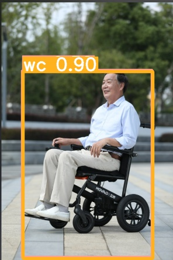

# 无障碍人群目标检测（YOLOv9）

用 YOLOv9 检测四类行动不便人群，用于无障碍场景的辅助识别：
**盲人（持盲杖）** / **拄单拐** / **拄双拐** / **坐轮椅**。

> 这是我在「人工智能训练师」赛项中完成的项目，从零走完了
> 数据筛选 → 标注 → 数据集拆分 → 训练 → 推理 的完整流程。

---

## 1. 背景

无障碍设施真正到位的前提，是系统能"看见"使用者。本项目训练一个目标检测模型，
把人+助残工具（盲杖、拐杖、轮椅）作为一个整体识别出来，
分四类输出，供后续的辅助决策使用。

---

## 2. 数据集

| 项目 | 内容 |
|---|---|
| 原始素材 | 150 张（网络图片，混合了无人物的干扰图） |
| 筛选后有效 | **149 张**（剔除 1 张无目标图片） |
| 类别数 | 4 |
| 标注工具 | labelImg（YOLO 格式） |
| 划分 | train : val = 9 : 1（固定随机种子，可复现） |

类别分布：

| 标签 | 含义 | 数量 |
|---|---|---|
| `wb` | 盲人（持盲杖） | 34 |
| `sc` | 拄单拐 | 20 |
| `dc` | 拄双拐 | 46 |
| `wc` | 坐轮椅 | 49 |

标注规则（自己定的，写在这里是为了让标注可复现）：
- 人物 + 助残工具（盲杖/拐杖/轮椅）整体框入，含毛发、衣角、背包
- 旁边有无关路人时与其区分，不并入同一框
- 导盲犬、倒影不标注
- 一张图有多个目标则全部标注

---

## 3. 方法

- 模型：**YOLOv9-c**（`yolov9-c.yaml`）
- 预训练权重：`yolov9-c.pt`
- 输入：640×640
- epochs：100
- batch size：1
- 训练脚本：`train_dual.py`（YOLOv9-c 为双头结构，必须用 dual 版本）

---

## 4. 结果

> 训练跑完后把实际数字填进来，别留空。

| 指标 | 值 |
|---|---|
| mAP@0.5 | 【训练跑完后填】 |
| mAP@0.5:0.95 | 【填】 |
| Precision | 【填】 |
| Recall | 【填】 |
| 单张推理耗时（CPU） | 【填】 |

推理示例：



---

## 5. 项目结构

```
.
├─ README.md
├─ .gitignore
├─ scripts/
│  ├─ filter_rename.py   # 按分类表批量重命名并归集图片
│  ├─ clean_labels.py    # 清理标注文件中的空行
│  └─ split_data.py      # 按 9:1 拆分 train / val
├─ docs/
│  └─ workflow.md        # 完整流程与踩坑记录
└─ data/
   └─ samples/           # 3~5 张示例图（不放全量数据）
```

> 原始图片、标注文件、模型权重都**没有上传**：
> 一是体积超限（GitHub 单文件限 100MB），二是原始数据不宜公开。

---

## 6. 怎么跑

```bash
# 1. 准备数据：图片放 datasets/VOCdevkit/JPEGImages，标注放 datasets/VOCdevkit/txt
#    txt/classes.txt 里写四行：wb sc dc wc

python scripts/clean_labels.py
python scripts/split_data.py

# 2. 训练
python train_dual.py \
  --weights yolov9-c.pt \
  --cfg models/detect/yolov9-c.yaml \
  --data data/data.yaml \
  --batch-size 1 --epochs 100

# 3. 推理
python detect_dual.py \
  --weights runs/train/exp/weights/best.pt \
  --source <待检测图片目录> \
  --conf-thres 0.5
```

---

## 7. 踩过的坑（这部分是写给自己看的）

1. **`classes.txt` 必须是四行 `wb/sc/dc/wc`，顺序不能换。**
   `data.yaml` 由它自动生成，文件为空会导致 `nc: 0`，训练直接崩；
   顺序写反则四类标签全部错位。
2. **labelImg 必须切到 YOLO 格式。** 默认可能是 PascalVOC，
   存出来是 xml 而不是 txt，后面全流程作废。
3. **路径不能有中文。** 中文路径会导致训练/推理报错或直接崩溃。
4. **训练只需要看第 1 个 epoch。** 验证链路是否通，看第一个 epoch
   的 loss 和 dataloader 就够了，不必等 100 个 epoch 跑完。
5. **训练失败不影响推理验证。** 环境中带有已训练模型时，
   可以用它先验证推理链路，把训练和推理解耦。
6. **重复图片要留意。** 素材里有完全相同的图（sha256 一致），
   若不去重会轻微影响 val 指标的客观性。

---

## 8. 后续想做的

- [ ] 补充夜间、逆光、遮挡场景的样本
- [ ] 量化后部署到边缘设备，看实际帧率
- [ ] 加一个简单的可视化 demo（输入视频 → 输出带框视频）
